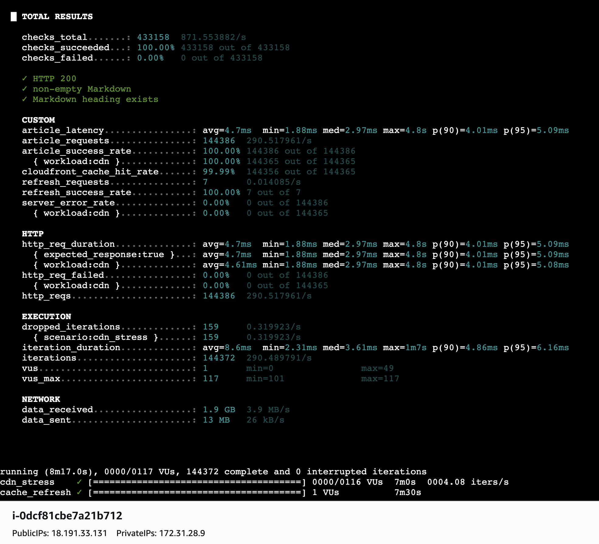

# OpenText Markdown Converter

Convert OpenText support articles into Markdown or JSON using a React interface and a Node.js/TypeScript API.

**[Live application](https://dizrmwyelhihs.cloudfront.net)** · **[API documentation](https://dizrmwyelhihs.cloudfront.net/#/docs)** · **[GitHub repository](https://github.com/Apollo87z/opentext-markdown-converter-assessment)**

## Assumptions and testing scope

| Item | Assumption / scope |
|---|---|
| API-key authentication | **Assumed** OpenText article access might require API-key protection, so an API key was added to this converter's article endpoint. This key protects the converter; it **does not authenticate users to OpenText** or bypass OpenText login restrictions. |
| Hosting | Assumed deployment to a hyperscaler serverless platform with CDN caching; AWS was selected for this implementation. |
| Workload | Assumed stateless, on-demand article conversions, making Lambda preferable to operating a Kubernetes cluster for this assessment. |
| Article availability | Only the **three supplied sample articles** were tested successfully; other articles were inaccessible. |
| Local development | Docker Compose runs locally without AWS infrastructure or credentials. CloudFront/WAF authentication and rate limits apply to the AWS-hosted deployment, not local Compose. |

## Quick start — Docker Compose

**No AWS account, credentials, or infrastructure are required for local use.** The repository includes `docker-compose.yml` and environment example files.

```bash
git clone https://github.com/Apollo87z/opentext-markdown-converter-assessment.git
cd opentext-markdown-converter-assessment

# Copy the provided .env.example file(s) to the .env locations
# referenced by docker-compose.yml, then adjust local values.

docker compose up --build -d
docker compose ps
```

To stop: `docker compose down`. To inspect errors: `docker compose logs -f`.

### Published container images (GHCR)

| Service | Image |
|---|---|
| Backend | `ghcr.io/apollo87z/opentext-markdown-converter-assessment:latest` |
| Frontend | `ghcr.io/apollo87z/opentext-markdown-converter-assessment-frontend:latest` |

The images are published by CI on pushes to `main`. Use `docker compose up --build -d` with the repository's build-based Compose configuration; if using a Compose configuration that references GHCR `image:` tags, run `docker compose pull && docker compose up -d` instead. Private GHCR packages require registry authentication.

## API

Full request/response examples are available in the **[hosted API docs](https://dizrmwyelhihs.cloudfront.net/#/docs)**.

| Method | Endpoint | Access |
|---|---|---|
| `GET` | `/api/v1/health` | Public |
| `POST` | `/api/v1/generate-key` | Public |
| `GET` | `/api/v1/articles?url=...` | `x-api-key` required |
| `GET` | `/api/v1/articles?url=...&forceRefresh=true` | `x-api-key` required |

```bash
curl --get 'https://dizrmwyelhihs.cloudfront.net/api/v1/articles' \
  -H 'x-api-key: YOUR_API_KEY' \
  -H 'Accept: text/markdown' \
  --data-urlencode 'url=https://my.opentext.com/support/article/1986936'
```

Use `Accept: application/json` for JSON output.


### Architecture diagrams

| Diagram | Link |
|---|---|
| High-level architecture | [View](Diagrams/High_Level_Diagram.png) |
| Request flow | [View](Diagrams/FlowChart.png) |
| Components | [View](Diagrams/Component_Diagram.png) |
| Security | [View](Diagrams/Security_Arch_Diagram.png) |
| CI/CD | [View](Diagrams/CI_CD_Diagram.png) |
| Sequence diagrams | [Browse](Diagrams/SequenceDiagrams/) |

## CI/CD and deployment

GitHub Actions builds and tests the solution on **pushes and pull requests**. Publishing and AWS deployment run only after successful checks on pushes to `main`.

| Stage | Actions |
|---|---|
| Backend CI | Node.js 24 → `npm ci` → tests → TypeScript check → build |
| Frontend CI | Node.js 22 → `npm ci` → optional tests → build |
| Publish | Multi-platform `amd64`/`arm64` backend and frontend images → GHCR |
| AWS deploy | GitHub OIDC → React build to S3 → CloudFront invalidation → ARM64 Lambda image to ECR → Lambda update |

**AWS is not needed locally.** To deploy on another hyperscaler, provision its serverless runtime, CDN, registry, authentication, rate limiting, and cache configuration, then deploy the appropriate container images.

## Security

On AWS, **authentication and rate limiting are handled at the edge**, not by backend Express middleware.

| Control | Current configuration |
|---|---|
| API-key validation | CloudFront Function hashes `x-api-key` using SHA-256 and checks CloudFront KeyValueStore |
| Missing / invalid key | `401 Unauthorized` |
| Key store unavailable | `503` (fail closed) |
| Key handling | Removes `x-api-key` before forwarding to origin |
| WAF: per API key | **100 requests / 5 minutes** on `/api/` paths |
| WAF: per IP | **600 requests / 5 minutes** on `/api/` paths |
| WAF limit response | `429`, JSON error, `Retry-After: 60` |
| AWS managed WAF groups | Common Rules, Known Bad Inputs, IP Reputation — **Count mode**, not blocking |
| Static assets | Private S3 via CloudFront Origin Access Control |
| Backend | HTTPS, URL validation, Lambda origin-header verification, IAM permissions |

The WAF thresholds are rolling-window rate controls, **not exact quotas**. The per-key rule groups by the supplied header value; the per-IP rule also covers requests without API keys. `/api/v1/generate-key` is currently public and should be restricted for broader production use.

## Assumptions and trade-offs

**Why Lambda instead of Kubernetes?** The converter is stateless and request-driven. Lambda provides managed scaling with less infrastructure to operate. Kubernetes would add cluster, ingress, node, and autoscaling management without a demonstrated need for this workload.

| Choice | Benefit | Trade-off |
|---|---|---|
| Lambda over Kubernetes | Low operational overhead; serverless scaling | Cold starts, concurrency and execution limits |
| CloudFront caching | Faster repeat requests; fewer OpenText calls | Potentially stale content |
| Edge API-key authentication | Rejects unauthorized requests before backend | AWS-specific KVS/Function integration |
| GHCR containers | Portable build artifacts | Provider-specific deployment setup still required |
| HTML → Markdown | Readable, portable output | Complex HTML may lose formatting |

## Testing

```bash
cd backend && npm ci && npm test && npx tsc --noEmit && npm run build
cd ../frontend && npm ci && npm test --if-present && npm run build
```

CI runs these checks automatically. `npm test --if-present` means frontend CI can pass when no frontend test script exists.

### Performance validation
### Performance validation — AWS EC2 and k6

Performance testing was conducted using **Grafana k6 v2.3.0** on an Amazon Linux 2023 EC2 instance (`x86_64`) in AWS `us-east-2`, targeting the deployed CloudFront distribution.

The test simulated increasing traffic across three OpenText support articles using two API keys, with a target load of up to **1,000 requests per second**. A separate scenario periodically tested the `forceRefresh=true` endpoint.

#### k6 stress-test results



**Key observations:**

- **144,386 HTTP requests** completed with a 100% success rate.
- **5.09 ms p95 response latency**, with an average of 4.70 ms.
- **99.99% observed CloudFront cache-hit rate**.
- **0 HTTP failures** and **0 server errors**.
- **433,158 validation checks passed**.
- **7/7 cache-refresh checks passed**, confirming successful HTTP responses but not independently verifying cache invalidation.
- **159 dropped iterations**, exceeding the configured zero-drop threshold.

#### CloudWatch monitoring

AWS CloudWatch recorded **610.85 RPS** during one sampled minute, with a **99.99% CloudFront cache-hit rate**, zero observed 4xx/5xx errors, and low Lambda invocation volume.

#### Conclusion

The results demonstrate strong scalability for **read-heavy, cacheable workloads**, with CloudFront serving most repeated requests without invoking the backend.

Although the test targeted 1,000 RPS, sustained throughput at that level was not established. Further testing with uncached articles, concurrent conversions, and geographically distributed clients is needed to validate broader production scalability.


## Known limitations

- **Article coverage:** Only three supplied sample articles were tested; other articles were inaccessible.
- **Upstream access:** API keys protect this service but do not grant OpenText login access.
- **Cache freshness:** Shared-cache TTL is 24 hours; original article changes may not appear immediately.
- **Force refresh:** Requires CloudFront to forward/bypass the cached variant; invalidation is asynchronous.
- **Invalidation granularity:** `/api/v1/articles*` is broad; CloudFront invalidation paths cannot include query strings.
- **Response variants:** CloudFront cache configuration must distinguish Markdown and JSON responses.
- **Production hardening:** Key expiry/revocation, protection of public key generation, load testing, monitoring, and rollback improvements remain future work.

## Repository structure

```text
backend/          Express, TypeScript, tests, Lambda Dockerfile
frontend/         React UI and documentation
docker-compose.yml
Diagrams/         Architecture and sequence diagrams
.github/workflows/ CI/CD
```
